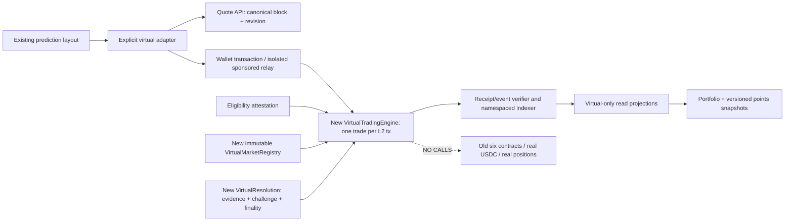

# Phase 2 — Virtual AMM architecture and accounting specification

**REVIEW ONLY — proposed, not implemented or approved.** Read with [threat model](PHASE2_THREAT_MODEL.md), [interfaces](PHASE2_INTERFACES.md), [integration/file plan](PHASE2_ADAPTER_AND_FILE_PLAN.md), and [approval gates](PHASE2_APPROVALS_AND_TESTNET.md).

## Evidence / scope

**SV** = inspected source at `323c12f1cb32c2082714e63aac9634dbb9dd4571` (Phase 1 docs on audited app baseline `2da5ae195cec916206e217ca71182b1baa8c39f7`). **LT** = isolated design arithmetic checks, explicitly not contract tests. **UV** = all new architecture, interfaces, limits, provider capabilities, security claims awaiting implementation/tests. **PV** = fresh production observation; none established here. This document does not authorize any deployment or economic decision.

No prediction UI code, old contract, manifest, configuration, secret, migration or production record changed. Existing six deployed addresses remain exactly as recorded in [Phase 1](PHASE1_AUDIT.md). The real Exchange, ConditionalPositions, Settlement and UpDownPool are not execution dependencies for virtual trades [SV].

## 1. Recommended model, subject to approval [UV]

A separate, finite-seeded **fixed-product market maker (FPMM)** with internal nontransferable outcome balances. One initiating wallet trades against protocol-owned virtual inventory in each transaction. Start design scope with 2 outcomes (crypto, binary sports) and 3 outcomes (football Home/Draw/Away). More outcomes require a new numerical/gas review; do not silently inherit the old 2–8 outcome range.

| Alternative | Price / liquidity | Strict distinct-transaction fit | Trade-off |
|---|---|---|---|
| Virtual CLOB | Real matching counterparties; orders can remain unfilled | Conventional buyer+seller fill shares one hash; conflicts with strict per-side requirement | More order lifecycle and market-maker operations; a signature is never a fill |
| Finite FPMM — recommended for review | Prices from funded virtual outcome reserves; finite depth | One wallet action against inventory, one L2 transaction | Slippage, inventory exhaustion, seed extraction and manipulation must be bounded |
| Signed dealer quotes | Authorized quote issuer sets price/depth | Can execute one action per transaction | Centralized price/risk authority and stale quote abuse; no claim of independent liquidity |
| LMSR | Logarithmic scoring rule, loss bounded by liquidity parameter | Possible | Fixed-point exp/log approximation and gas/security complexity; defer rather than casually implement |

The AMM is not real-USDC liquidity, a guaranteed fill, or an oracle of event truth. Equal initial reserves imply equal model probabilities, not externally verified fair odds. Thin pools can have unrealistic prices. Existing BTC/ETH spot charts remain reference asset prices, not outcome-share execution prices.

## 2. Data flow and isolation [UV]



One canonical active virtual engine is required for the transaction-wide trade guard. Different addresses must not each accept a trade inside the same transaction; future engines require a shared coordinator or an explicitly approved migration design. Market identifiers are `(chainId, engine/deploymentId, marketId)`, never a bare integer shared with real markets.

## 3. Units, issuance and conservation [UV]

- `U = 1_000_000`. Cash, shares and cost basis use integer atomic units. One winning share pays `U` Virtual USDC atoms per `U` share atoms. No floating point execution.
- Each eligible wallet can claim **exactly `500 * U` once**. Campaign changes must not reset the lifetime wallet claim flag. Eligibility rules and total participant/grant cap remain UNAPPROVED. A signed/allowlisted attestation binds chain, engine, campaign, wallet, expiry and one-use eligibility nullifier. Wallet uniqueness alone is not human uniqueness.
- No virtual ERC-20 or ERC-1155; no deposit, withdrawal, transfer, bridge, cash redemption, arbitrary balance setter, administrative wallet credit, or real token approval. Referral metadata/legacy points are not spendable virtual grants.
- Seed `S` is separately budgeted protocol virtual issuance, locked to a market. It never credits an operator wallet. At activation, collateral `C=S` and each reserve `r_i=S`. A market can consume only an approved fixed seed template within an immutable campaign hard cap; creators cannot supply arbitrary seed amounts. Actual templates/caps remain UNSET.
- Every pre-terminal outcome has `poolReserve_i + totalUserShares_i = C`. Buying creates complete sets with cash; selling redeems complete sets. Fees are retired to a nonspendable virtual sink.
- System cash conservation: `issuedGrants + issuedSeeds = userCash + lockedMarketCollateral + feeSink + terminalProtocolSink` (plus explicit bond escrow only if a bond option is approved). Moving cash into positions is not issuance. Shares are claims against locked *virtual* collateral, not additional cash.
- On finalization, pool-owned payouts are retired, not paid to an admin. No LP withdrawal, post-activation top-up, inventory reweight, rescue-to-admin, or claim-expiry sweep. Unclaimed user payouts remain reserved; rounding dust remains locked/accounted, never new spendable credit.

**Storage safety bounds, not business budgets:** proposed at most 3 outcomes, positive reserves bounded by `uint64.max`, so the product is at most 192 bits and three-term price-weight sums fit 256 bits. Enforce bounds before multiplication/addition; cap search output to `uint64.max`. Cash/basis may use checked `uint128`, cumulative signed PnL `int256`. Grant/seed issuance hard caps must also keep all totals in range. These are proposed constraints requiring fuzz/proof review, not gas-optimized approved layout.

## 4. Exact pricing [UV]

For positive reserves `r[0..N-1]`, `K = product(r_i)`. Marginal pre-fee probability:

```
w_i = product(r_j for j != i)
p_i = w_i / sum(w_j)
```

This is equivalent to normalized inverse reserve, and probabilities sum exactly to one as rationals. Display rounding can use largest-remainder allocation to sum to 100%; rounded display numbers never drive execution. Prices are endogenous AMM prices; external source data determines event resolution, not a hidden administrator price override.

### Buy — exact gross cash input B, selected outcome i

```
f = ceil(B * feeBps / 10_000)   # f=0 when feeBps=0
x = B - f
r'_j = r_j + x                 # for every j != i
r'_i = ceil(K / product(r'_j for j != i))
q = r_i + x - r'_i             # user shares received
```

Require `B>0`, `x>0`, `q>0`, sufficient cash, minimum output, deadline/revision and all risk bounds. Debit `B`, credit shares `q`, increase selected position basis by **gross `B` including fee**, increase `C` by `x`, retire fee `f`. New product is at least old product due to conservative rounding.

Gross average execution price per share is `B*U/q` cash atoms; it differs from marginal `p_i*U`. Events store exact input/output/fee, so rounded average price is derived, not an authoritative accounting input.

### Sell — exact owned shares q, selected outcome i

Add `q` to selected inventory, then redeem `y` complete sets. Select the **largest integer y** within the valid range satisfying:

```
(r_i + q - y) * product(r_j - y for j != i) >= K
all resulting reserves >= their approved positive reserve floor
0 <= y <= C
```

Upper bound is the minimum of `C`, all `r_j-floor_j` for `j != i`, `r_i+q-floor_i`, output/risk caps and `uint64.max`. The product decreases monotonically on this positive interval: a bounded integer binary search can select maximal `y` (at most 64 iterations under the proposed bound). Actual gas cost is **unmeasured**; optimize only after reference equivalence and tests, never by weakening the transaction rule.

```
f = ceil(y * feeBps / 10_000)
z = y - f                        # net virtual cash to user
r'_i = r_i + q - y
r'_j = r_j - y                    # j != i
C' = C - y
```

Debit only owned `q`, credit net `z`, retire `f`. Reject zero net output, over-selling, invalid outcome, closed/paused market or bounds violation. No shorting, leverage, transferable shares or offchain balance workaround.

### Limits, spread and insufficient liquidity

Each market freezes its fee, seed, reserve floors, storage bounds, outcome definitions, max trade size, max position/exposure and any inventory/price limits before activation. Values await approval. Zero-fee versus fixed-fee options have different churn incentives; no fee chosen here. A fee plus curve impact creates an effective buy/sell spread; no fake orderbook spread/depth.

Reserve floors prevent depletion but cannot guarantee exit. A sell may fail due to floor/depth caps even when a wallet owns shares. Show executable maximum size and reason; offer a smaller **new quote**, not automatic partial execution. A user can explicitly sell part of a position. Exact-input Buy / exact-shares Sell either completes atomically or fully reverts. Pending transactions, insufficient sponsored budget, or stale quotes do not consume virtual cash or create a confirmed position.

## 5. Slippage and freshness [UV]

Quote binds chain, deployment/engine, wallet, market/outcome, side, exact input, expected output, fee, reserve revision, canonical block hash/number, deadline and model version. API quotes are simulations, not authorization to change prices. Contract recomputes from its own state.

- User sets `minSharesOut` for Buy or `minCashOut` for Sell. For chosen slippage `s`, a possible conversion is `floor(quotedOutput*(10_000-s)/10_000)`, always positive and above minimum economic units. No default tolerance approved.
- Existing limit-price field could mean maximum **gross average Buy price** or minimum **net average Sell price**, not a resting limit order. Then Buy requires `q >= ceil(B*U/maxPrice)`; Sell requires `z >= ceil(q*minPrice/U)`.
- **Option A, recommended pilot:** exact reserve revision; concurrent changes cause re-quote/revert even if favorable. Simpler safety, more stale-transaction gas and griefing.
- **Option B:** allow a newer revision subject to minimum output/deadline. Better concurrency, greater sandwich/MEV exposure. Never silently switch modes.
- Deadlines, minimum economic size, maximum tolerance and optional cooldown are approval items. Pausing on bad reference data is a separately specified source-health policy; it cannot rewrite published outcomes/rules.

## 6. Worked example and arithmetic review [LT, not contract-tested]

**Illustrative only, not approved seed or fee:** binary reserves 100/100 Virtual USDC shares, zero fee, Buy gross 10:

| Item | Exact 6-decimal result |
|---|---:|
| Shares received | 19.090909 |
| Reserves after Buy | 90.909091 / 110.000000 |
| Approx. new marginal selected probability | 54.7511% |
| Average gross Buy price | about 0.523810 Virtual USDC/share |
| Alternative immediate full Sell | 9.999999 Virtual USDC |
| Full round-trip realized PnL | -0.000001 |
| Instead Sell 9.545454 shares (roughly half) | 5.113442 Virtual USDC |
| Basis removed for that partial Sell | 4.999999 Virtual USDC |
| Partial realized PnL | **+0.113443** |

The partial-profit example is a critical points-abuse warning: self-induced price movement can produce positive *realized* PnL while the remaining position carries offsetting loss. Never reward each positive partial sale independently.

1,200 deterministic scratch arithmetic scenarios (2/3 outcomes, example fees 0/50/100 bps) checked product monotonicity, outcome inventory conservation, positive reserves, immediate full round-trip non-profit and basis conservation. See [evidence](phase2-design-evidence.json). These are finite formula sanity checks, **not Solidity fuzzing, a proof, a gas benchmark, or a security audit**. No new protocol was implemented.

## 7. Market lifecycle and resolution [UV]

`Prepared -> Seeded/Scheduled -> Open -> Closed -> Proposed -> Disputed? -> Final(Outcome or Void) -> per-owner Settled`.

Time gates apply onchain even if a scheduler fails. No trading at/after `closeAt`; trades cannot depend on an API saying “Open.” Each immutable terms hash covers ordered outcomes, asset/fixture ID, event interval, opens/closes, resolve-after, evidence source/fallback, tie/rounding rules, challenge duration, dispute authority, timeout-to-void rule, fee/model and limits. No edits to terms with existing positions; cosmetic metadata changes must be versioned and not contradict rules.

- Crypto: separate virtual series for BTC/ETH/SOL/BNB and 5/15/30/60/720/1440 minute intervals. Pin source, pair, timestamp boundary, exact sample selection/staleness, decimal rounding and equality outcome before opening. BNB data coverage is not established merely by an existing `BNB-USD` constant [SV].
- Sports: pin league/fixture, full-time vs extra-time/penalties, draw/abandonment/postponement, score corrections and finality provider. Football and cricket use explicit ordered outcomes. APIs/AI can suggest evidence, not silently finalize.
- New resolution adapter only; old Oracle has a real-USDC bond and immutable 86,400-second challenge [SV]. A 5-minute trading window is not a promise of settlement five minutes later.
- Proposer supplies evidence hash/content reference after resolve-after; separate challenge/finalization permissions. Challenge duration and quorum remain approval decisions. Suggested pilot option: independent allowlisted watchers plus a separate multisig adjudicator (centralization disclosed). Alternative public challenge without real funds needs virtual bond or anti-griefing review; a first challenge must not extend indefinitely on repeated calls. Fixed dispute deadline and precommitted timeout/void prevent endless operator discretion. Do not introduce real-USDC bonds.
- Any emergency guardian can stop **new trading**, not rewrite balances/results or confiscate claims. Resume requires a stronger role and review. Settlement of final valid markets should not be blocked by a trading-only pause.

**Normal settlement:** final winning shares pay 1 Virtual USDC/share; other outcomes pay zero. Pay only the owner, clear basis/quantity once, update realized PnL, retire pool-owned winnings. Anyone may trigger `settleFor(owner, market)` but cannot redirect proceeds. Finalized outcome cannot be changed after a payout. Evidence/appeal policy must handle errors before irrevocable finalization.

**Void proposal for approval:** each outcome pays `1/N` per share. This is neutral complete-set redemption, **not purchase-price refunds**. Aggregate an owner's outcome share numerators before integer division; pay `floor(sum(Q_i)/N)` atoms. Document cross-owner rounding dust; keep it reserved/accounted and never credit an operator. Pool-owned share payout is separately retired. Exact remaining dust and outstanding claims stay in terminal collateral accounting. No new virtual cash is minted to repair rounding. Alternative cost-basis refund does not naturally conserve this AMM and is not supported without a different design.

## 8. Position / PnL specification [UV]

Per wallet/market/outcome: quantity `Q`, gross remaining basis `B`, cumulative realized PnL. Buy adds `q` and gross cash cost including fee. For a partial Sell:

```
removedBasis = floor(B * soldShares / Q)
# closing all remaining shares removes all remaining basis, including rounding residual
realizedDelta = netSellProceeds - removedBasis
remainingBasis = B - removedBasis
```

Final settlement realizes payout less all remaining basis. Average cost, not FIFO; make method explicit and immutable per engine version. Use wide intermediates/checked casts.

Unrealized PnL = `floor(Q * exact marginal p_i) - remainingBasis`, computed from one canonical block. Also show net executable liquidation quote separately; it includes depth/fees and can be unavailable. Marginal valuation is an estimate, not a guaranteed sale. Grants, seeds, referral credits and points are excluded from trading PnL and volume. If data fails, show a stale/error state, not fabricated zero; genuine new zero positions remain zero.

## 9. Monthly TAC Points — proposal, all weights/budgets UNSET [UV]

Inputs only from finalized verified engine events. Report gross Buy cash and net Sell proceeds separately; one initiating trade contributes once to any selected volume definition, never both Trade and PositionUpdated events. Do not call onchain seeds/grants/claims trades.

Proposed formula family:

`score_u = wV * normalize(eligibleVolume_u) + wP * normalize(eligibleRealizedPnl_u) + wD * normalize(eligibleDays_u)`.

Choose weights, normalization (linear/capped/square-root), caps, minimum holding/risk/activity, and monthly reward budget **before** implementation/configuration. None is approved; Phase 1 illustrative weights are not defaults. Negative PnL must net across eligible episodes before any positive clamp; disclose whether losses yield zero profit component or a risk penalty. Unrealized PnL is reported separately and never awarded as realized profit.

**Selective-realization protection options:** (A) score only completed wallet/market inventory episodes, deferring open episodes, or (B) hold PnL allocation until market resolution and all owner's outcomes settle, or (C) approved negative-unrealized-loss holdback with reconciliation. Recommend A or B for a pilot. Open losing positions, offsetting outcomes, a new wallet, or late settlement must not selectively erase losses. Realized losses remain recorded; carry/holdback rules across month boundaries must be approved. A wallet can permissionlessly have final markets settled on its behalf to stop cherry-picking claims.

Volume options: risk-increasing Buy volume only (simpler, still farmable), or risk/time-qualified turnover including Sells (fairer to exits, harder validation). Exclude reverted/failed/reorged/unmatched events. Repetitive offsetting trades, rapid round trips, cross-wallet manipulation, linked identities, source/relay anomalies and seed extraction get deterministic versioned flags/holdbacks, not claims of Sybil prevention. Publish reasons and an appeal procedure; never silently change historical rules.

Define months in UTC, snapshot at the final canonical block before cutoff, then wait finality. Persist block/hash, event range/digest, formula/config version, exclusions/evidence, normalized input totals, integer rounding and approver. Missing price/resolution/indexer data blocks or explicitly defers affected rows; no made-up metrics. Late finalization/settlement follows an approved carry rule, not retrospective overwrites. Recompute identical snapshots deterministically.

Recommend **database points ledger first**, with a unique `(month, formulaVersion, wallet)` allocation and one approved publication ID; no token mint/transfer or cash value promise. Optional later onchain Merkle-root anchoring provides tamper evidence but adds gas, publication authority and root-correction rules. Dedicated claims contract only after a separately approved claim/distribution requirement. If budget is unset or reconciliation incomplete, no final distribution. Rewards and TAC Points never become spendable Virtual USDC by implication.
